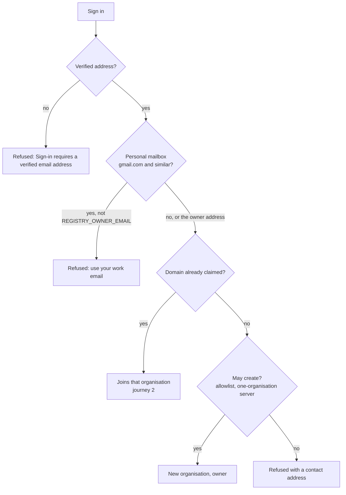

# Journey 1: Set up the organisation

- **Persona:** [Org owner](../personas.md#org-owner)
- **Trigger:** the company decides to try Guard. On Vibtra Cloud, Vibtra has added the owner's address to the
  sign-up allowlist. On a self-hosted server, the [self-hoster](10-self-host.md) has started the server.
- **How-to:** [guide/README.md](../../guide/README.md#vibtra-cloud) (Cloud), [guide/self-host.md](../../guide/self-host.md#4-sign-in)
  (self-host).

## Happy path

1. **Open `/login`.** The page says "Sign in to Guard" and shows one button: "Continue with Google" or "Continue
   with <provider name>". There is no sign-up form and no password.
2. **Sign in with the identity provider.** The provider must confirm the address is verified.
3. **The server creates the organisation.** It is named after the mail domain (for example `acme.com`), with an
   address (handle) made from it. The person becomes its **owner**. The organisation claims the domain. Code:
   `planOrgForSignIn` and `applyOrgPlan` in `apps/registry/src/tenancy/claim.ts`.
4. **`/start` sends them to the dashboard** at `/<org>/guard`. The **Overview** shows "No laptop has checked in yet"
   with **Enrol the first laptop**, and, in Monitor, "Monitoring only: rules aren't enforced yet" with **Switch to
   enforce**.
5. **Check the mode.** **Settings** (the gear), **Protection**, **Mode** is the default for everyone. A new
   organisation is in **Monitor** unless the server sets `GUARD_QUICK_START=1`. People can be set one by one under
   **People**, **Protection** ([journey 12](12-protection-modes.md)).
6. **Write the staff notice.** **Settings**, **Staff notice**. **Start from the template**, edit, preview,
   **Copy the notice**. The invitation and reminder emails include it.
7. **Invite a second admin.** **People**, **Invite people**, role **Admin**. Then [journey 2](02-invite-and-onboard.md).
8. **Hand over.** To make someone else an owner, invite them first, then change their role on **People**. Only an
   owner can make or unmake an owner, and the last owner cannot be removed.

What the system records: the user, the organisation (name, handle, claimed domain, join policy `domain`), the owner
membership, and the first sign-in time, which the funnel reads.

## Branches

- **Not on the allowlist** (Vibtra Cloud, or self-host with `REGISTRY_REGISTRATION=allowlist`). "Vibtra is onboarding
  by invitation right now, so <email> was not signed up and nothing was created." plus "Write to <contact>" when
  `REGISTRY_CONTACT_EMAIL` is set. Nothing is created.
- **Personal mailbox.** "Use your work email to create an organisation." The exception is `REGISTRY_OWNER_EMAIL`: it
  creates an organisation named after the part before the `@` that claims no domain, so every colleague needs an
  invitation.
- **Domain already has an organisation.** The person joins it as a **member** if its join policy is `domain`.
  If it is `invite`, they are refused with the names of up to a few admins to ask.
- **Domain belongs to a closed organisation.** Refused: "<org> is closed… closing cannot be undone."
- **Second organisation on a one-organisation server.** Refused unless invited ([journey 10](10-self-host.md)).
- **Provider error.** `/login` shows a plain message for each error code ("Sign-in was cancelled…", "Sign-in took too
  long, or started in another tab…"), and a retry.
- **A member opens the dashboard.** Every page says "That page is for organisation admins". Members have nothing to
  do in the dashboard.

## Gaps and open questions

- **Settings links lead to a 404.** **Settings**, **Organisation**, **Sign-in**, "Open sign-in settings", the account
  menu's "Open the Vibtra console" and the group sheet's "Rename or delete a group in the Vibtra console" all link to
  `/<org>` or `/<org>/settings` (`apps/guard-console/src/pages/Settings.tsx:346`,
  `apps/guard-console/src/shell/AccountMenu.tsx:72`). The Guard route boundary answers "Not part of Guard"
  (`apps/registry/src/guard/product-boundary.ts:46`). Leftover from the earlier product.
- **Per-organisation SSO and join policy have no UI.** The API routes `/api/console/sso` and `/org-joining` exist,
  and the Community Edition advertises per-organisation OIDC SSO, but no Guard page sets them. The owner cannot
  switch the join policy to `invite`, so anyone on the domain who signs in joins as a member.
- **Organisation name is the domain.** It is read-only in **Settings**. Renaming exists in the store
  (`renameOrg`) but not in the dashboard.
- **No way to close the organisation** from the dashboard, although sign-in refusals talk about closed
  organisations. Decide whether owners should be able to close it, and what happens to devices and events.
- **"Vibtra" in self-host copy.** The allowlist refusal names Vibtra on any server (`apps/registry/src/tenancy/claim.ts:206`).
- **The owner is in the funnel too.** The owner starts at **Signed in** and lands on the chase list after 7 days
  without a Mac. There is no way to say a person has no Mac to protect.
