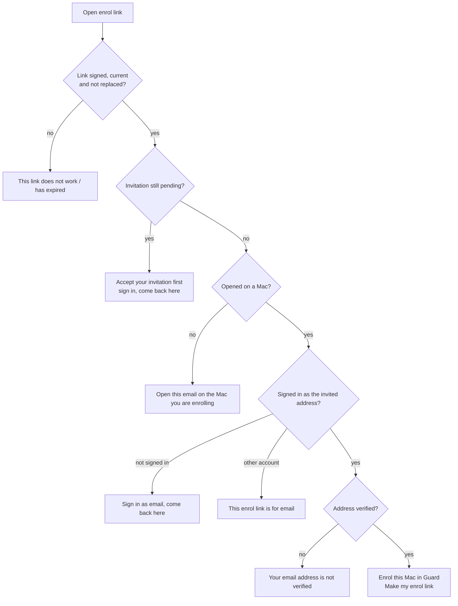

# Journey 3: Get my Mac protected

- **Persona:** [Employee](../personas.md#employee)
- **Trigger:** the invitation email from IT arrives ([journey 2](02-invite-and-onboard.md)).
- **How-to:** [guide/mac.md](../../guide/mac.md) covers install, certificate trust and the network extension.
- **Off the links:** when the person skips or loses a link, see [journey 4](04-off-path-recoveries.md).

## Happy path

The email has three numbered steps and the staff notice. The person follows them in order, on their Mac.

1. **Read the email.** "<admin> invited you to join <org> on Vibtra Guard." The staff notice says what Guard records.
2. **Step 1: accept the invitation.** The link opens `/login?invitation=<id>`. The page adds "You have an
   invitation. Sign in with the address it was sent to, and you will join that organisation." The person signs in.
   `/start` accepts the invitation. The system records the membership with the invited role and the first sign-in.
   Funnel: **Signed in**.
3. **They land on the dashboard.** A member sees "That page is for organisation admins". They go back to the email.
4. **Step 2: download Guard.** `/guard/download/<token>` redirects to the server's download address. Without one it
   shows "Your IT team sends Guard". They open the disk image, drag Vibtra Guard to Applications and open it. It runs in the
   menu bar with no window. macOS asks to allow notifications.
5. **Step 3: enrol.** The enrol link opens `/guard/enrol/<token>` on the Mac. The page says "Enrol this Mac in Guard"
   and "Guard enrols this Mac in <org> for <email>." The person presses **Make my enrol link**.
6. **"Your enrol link is ready."** It works once, on one Mac, for 24 hours. The page repeats **Download Guard** for
   anyone who skipped step 2, then **Open Guard and enrol**, and a Terminal command. The system records an enrol link
   minted by the person, from their onboarding email (`guard.enrol_link.minted`).
7. **Open Guard and enrol.** The `vibtra-guard://enrol?...` link opens the app's **Enrol this Mac** window with the
   link filled in. The person presses **Enrol**. The agent enrols, pins the server's signing key and syncs the rules.
   The window shows "Enrolled and synced. Trust the local CA, then run the agent." The server consumes the link and
   records the device (`guard.device.enrolled`). Funnel: **Enrolled**.
8. **Trust the certificate.** An alert "Trust Guard's new certificate" offers **Trust certificate…**. macOS asks for
   the login password. At the next check-in the Mac reports the certificate as trusted. Funnel: **Certificate
   trusted**.
9. **Turn on the network extension.** The panel shows **Install network extension**. macOS asks the person to allow
   it in System Settings, then **Turn on network protection**. The panel shows "On: AI sites go through Guard".
10. **Protected.** AI requests now go through Guard. The panel shows the person, the organisation, the mode and
    **Last sync**. The person can close the email.

## Enrol page branches

The enrol page (`apps/registry/src/onboarding/entry-routes.ts`) checks in this order:

- **Too many tries.** More than 30 opens a minute from one address: "Too many tries. Wait N seconds".
- **Server cannot enrol.** "Enrolment is not available. Ask IT for an enrol link instead."

## Mac branches

- **Enrol link used or expired.** The server says "That enrol link is unknown, used or expired", but the window shows
  "vibtra-guard: registry answered HTTP 400" and "Enrolment failed (exit 1)" (`guard/agent-go/sync.go:121`).
- **Link for another server.** "This enrol link is for another server (X). This copy of Guard enrols only with Y."
- **Enrolled, first sync failed.** The Mac is enrolled on the server, but the window shows "Enrolment failed
  (exit 1)" and the app does not start the agent.
- **No Secure Enclave, or an unsigned build.** A red card "This Mac is not protected" with the reason. The dashboard
  shows the device as **Not protected**. AI traffic goes through unchecked.
- **Certificate not trusted yet.** An amber card: "Until you trust it, AI requests go through without Guard checking
  them."
- **Extension waiting for approval.** "Waiting for approval in System Settings → General → Login Items & Extensions →
  Network Extensions", with **Open Network Extensions settings**.
- **Command-line tools.** Node, Python, curl and git need **Trust for command-line tools…** and the shell lines it
  shows ([mac.md](../../guide/mac.md#command-line-tools)).
- **The Mac restarts.** Guard does not start at login. Nothing is checked until the person opens the app, and the
  Mac goes **Late** ([journey 8](08-device-late-or-tampered.md)).

## Gaps and open questions

- **The sign-in step ends on an admin-only page.** The invitation link carries no `next`, so `/start` sends a new
  member to `/<org>/guard`, which says "That page is for organisation admins"
  (`apps/registry/src/guard/entry-pages.ts`, `apps/guard-console/src/auth/AuthGate.tsx`). A members' landing page
  that says "Now download Guard and enrol this Mac" would close it.
- **No guided next step after enrol.** Success shows the command-line text "Trust the local CA, then run the
  agent." The panel is a flat list of actions, not an ordered checklist. The person has to work out the order.
- **Opaque enrol errors.** "registry answered HTTP 400" hides the server's plain message. A used or expired link
  should say so and point to **No enrol link? Get one**.
- **`docs/guide/mac.md` says "The app opens and enrols".** In the code it opens the window filled in, and the person
  presses **Enrol**.
- **The Terminal command is wrong.** The server shows `vibtra-guard enrol …`, which is not on the `PATH`
  (`apps/registry/src/guard/service.ts:761`). The guide uses the full app path.
- **Two link types, one word.** The email's "enrol link" (`/guard/enrol/…`, 14 days, many uses) and the Mac's enrol
  link (`vibtra-guard://…`, 24 hours, one use) are different things with the same name.
- **No start at login.** Every restart leaves the Mac unchecked until the person opens the app.
- **Developer text shown to people.** "agent binary missing: build guard/agent" (`guard/mac/VibtraGuard/StatusPanel.swift:19`,
  `guard/mac/VibtraGuard/EnrolView.swift:93`).
