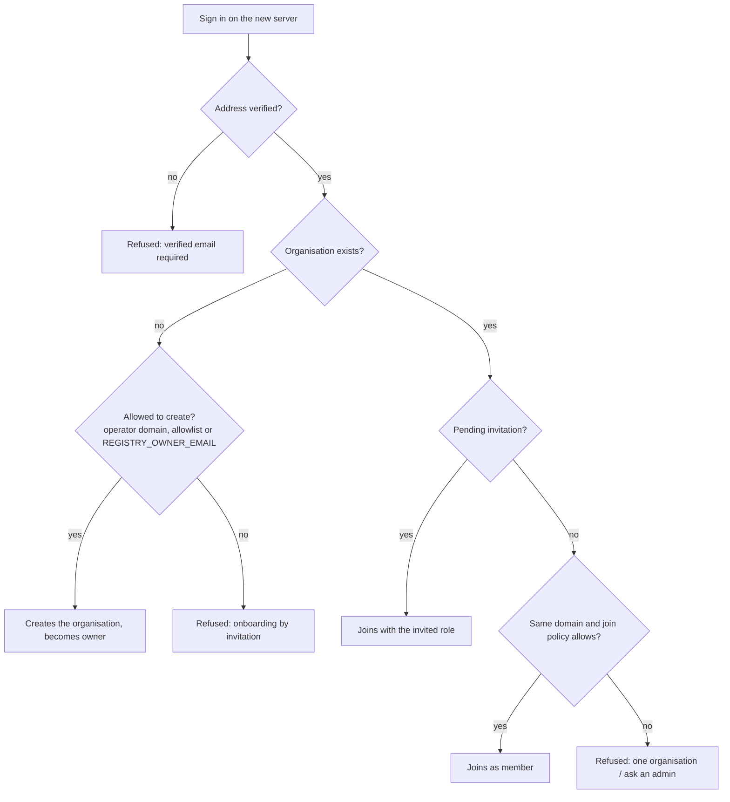

# Journey 10: Run your own server

- **Persona:** [Self-hoster](../personas.md#self-hoster)
- **Trigger:** the organisation wants Guard but will not send device metadata to Vibtra Cloud, or wants the free
  Community Edition.
- **How-to:** [guide/self-host.md](../../guide/self-host.md) (short path) and [self-host.md](../../self-host.md)
  (operator reference). This page is the journey, not the recipe.

## Happy path

1. **Register a sign-in client.** The self-hoster makes an OpenID Connect client in their identity provider, or a
   Google OAuth client. The provider must send `email_verified: true`, or nobody can sign in.
2. **Fill in the env file.** They copy `apps/registry/self-host.env.example` outside the checkout and set at least
   `REGISTRY_BASE_URL`, `GUARD_DB_PASSWORD`, the OIDC settings, `REGISTRY_REGISTRATION=allowlist` and
   `REGISTRY_OPERATOR_DOMAIN` (or `REGISTRY_OWNER_EMAIL` for a personal mailbox).
3. **Start it.** `docker compose ... up -d --wait`. On first boot the server writes three secrets to
   `/data/secrets.env` in the `guard-data` volume and runs migrations. A bad setting stops the boot with a named
   message ([failure table](../../guide/self-host.md#if-it-does-not-start)).
4. **Put TLS in front.** Guard listens on `127.0.0.1:4700` only. A reverse proxy serves the `https://` address.
5. **Sign in.** The first person with a verified address on the operator domain creates the organisation and becomes
   its owner. This is [journey 1](01-org-setup.md) from step 3.
6. **Choose the mode.** A new organisation opens in **Monitor**, unless `GUARD_QUICK_START=1`. Then it opens in
   **Enforce** with the starter rules.
7. **Get a Mac client that talks to this server.** A signed copy of Guard talks only to the server built into it.
   Vibtra's download is built for `https://vibtra.app`, so it cannot enrol with a self-hosted server
   ([mac.md](../../guide/mac.md#which-server-guard-talks-to)). The self-hoster signs Guard under their own Apple team
   with `--registry-url` set to their server ([self-signing.md](../../guide/self-signing.md)), or builds it unsigned
   for a trial. An unsigned build cannot turn on the network extension and checks no traffic.
8. **Enrol the first Mac.** **Devices**, **Enrol device**, then the [employee journey](03-employee-onboarding.md).
9. **Back up.** Postgres and `secrets.env` together. One without the other is useless, and every Mac would have to
   enrol again.

## Optional: turn on mail

With mail off, the dashboard shows a copyable invitation link and the admin sends it themselves
([journey 2](02-invite-and-onboard.md#mail-off)). To send invitation, reminder and request emails from the server:

| Setting | Effect |
|---|---|
| `RESEND_API_KEY` and `REGISTRY_MAIL_FROM` | Mail goes through Resend from a verified sender. Either one alone stops the boot. |
| `VIBTRA_MAIL_ADAPTER` | `none`, `resend`, or the name of an adapter registered in code. Unset means `resend` when a key is set, else `none`. A name nobody registered stops the boot. |
| `VIBTRA_GUARD_DOWNLOAD_URL` | Where the email's **Download Guard** link redirects. Unset: the link opens a page that says "Your IT team sends Guard". |

The adapter port is `MailAdapter` in `apps/registry/src/mail/mailer.ts`. The only built-in adapter is Resend
(`apps/registry/src/mail/built-in.ts`). A custom adapter (SMTP, SES and so on) has to be registered in code through
`RegistryCliOptions.mailAdapters`. There is no SMTP adapter.

## Branches

- **Personal mailbox, no `REGISTRY_OWNER_EMAIL`.** gmail.com and similar cannot create an organisation. Refused.
- **Second domain on a one-organisation server.** Refused with "This Guard server has one organisation…" unless the
  address holds an invitation (`apps/registry/src/tenancy/claim.ts:161`).
- **`secrets.env` lost, database kept.** The server refuses to start. Restore it from the same backup.
- **Upgrade from guard-v0.1.0.** Gives each organisation its own signing key. Every Mac must enrol again.
- **Server down.** Macs keep their last verified rules and queue events ([restart.md](../../guide/restart.md)).

## Gaps and open questions

- **The Vibtra download cannot reach a self-hosted server.** A self-hoster needs a paid Apple Developer organisation
  account and a re-sign for every release before one Mac is protected. `guide/self-host.md` step 6 sends them
  straight to `mac.md` without saying so, and `guide/self-signing.md` says "you only need this page if you want your
  Macs to trust your own Apple team", which reads as optional. Decide: ship a self-host build that accepts a server
  at enrol, or say plainly that self-host needs self-signing.
- **Compose does not pass the mail settings.** `apps/registry/docker-compose.yml` lists its environment one by one
  and has no `RESEND_API_KEY`, `REGISTRY_MAIL_FROM`, `VIBTRA_MAIL_ADAPTER` or `VIBTRA_GUARD_DOWNLOAD_URL`. Setting
  them in the env file does nothing. Mail is documented only in `apps/registry/README.md`, not in
  `docs/self-host.md` or `self-host.env.example`.
- **No SMTP adapter.** Most self-hosters have SMTP, not Resend. A custom adapter means changing code.
- **Vibtra wording on a self-hosted server.** The allowlist refusal says "Vibtra is onboarding by invitation right
  now" (`apps/registry/src/tenancy/claim.ts:206`), and the invitation email subject says "on Vibtra"
  (`apps/registry/src/mail/templates.ts:33`).
- **No health signal for mail.** A failed send is a WARN log line (`apps/registry/src/mail/mailer.ts:93`). The admin
  sees a copy link, but nothing tells the operator that mail is broken.
